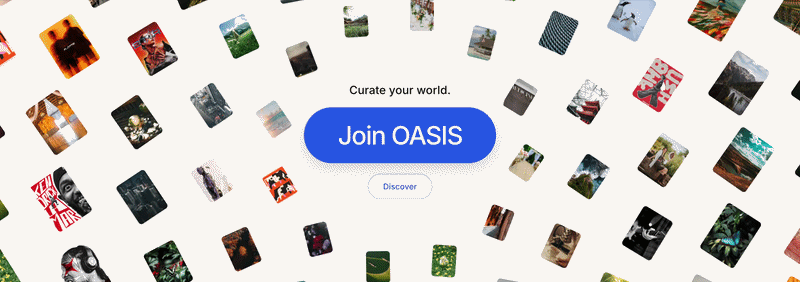
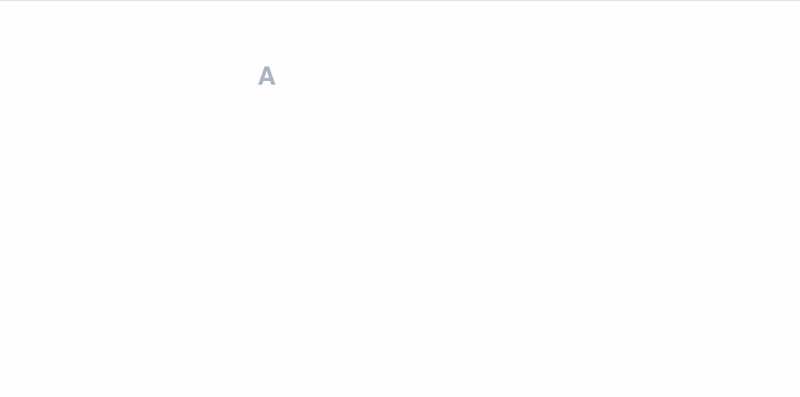
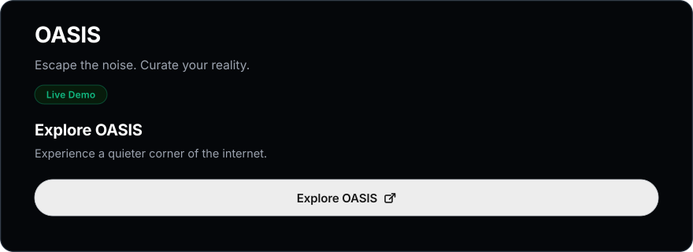

<div align="center">



<p align="center">
  
  
  
  
  
  
  
</p>

[](https://oasis-blog-one.vercel.app/)

</div>

---

## 📋 Table of Contents

1. [About OASIS](#about-oasis)
2. [Features](#features)
3. [Tech Stack](#tech-stack)
4. [Technical Highlights](#technical-highlights)
5. [Project Structure](#project-structure)
6. [Privacy & Security](#privacy--security)

---

## About OASIS

OASIS is a digital space designed for people who value thoughtful content over endless scrolling.

Built around the principles of Swiss minimalism, it offers a calm environment for writers, photographers, and creatives to share stories, explore ideas, and connect through meaningful conversations.

No endless scrolling or opaque engagement loops. Just thoughtful content, transparent discovery, and a creative community — at a human pace.

---

## Features

### ✍️ Editorial Publishing

- Rich-text article editor with customizable titles, subtitles, and categories.
- Cover image uploads with instant previews.
- Draft management, live previews, and author-only editing.

### 🌐 Discovery & Community

- **Tri-Modal Discovery Feed:**
  - For You — personalized, score-based recommendations.
  - Latest — chronological publications.
  - Top — community-engagement ranking.
- Search stories and creators.
- Six curated categories with dedicated subcategories.
- Public creator profiles, following, and threaded discussions.

### 🔖 Personal Collections

- Private bookmarks and saved article collections.
- Personalized following feed with creator recommendations.
- Native sharing with direct links and social shortcuts.

### 🔐 Authentication & Security

- Email/password and Google OAuth authentication.
- Cross-device QR authentication.
- Account management and active session controls.

### 🔔 Real-Time Experience

- Live notifications powered by Supabase Realtime.
- Notification preferences and synchronized unread counts.

### 📊 Creator Analytics

- Rolling 30-day performance analytics.
- Follower growth and story engagement metrics.
- Bookmark statistics and adaptive baseline indicators.

---

## Tech Stack

### Frontend
- **React 19**
- **Vite 8**
- **React Router v7**
- **React Context API** (Auth, Notifications & Toast)
- **GSAP 3.12 & ScrollTrigger**
- **CSS3** (Modular Architecture, Flexbox & Grid)

### Backend & Infrastructure
- **Supabase** (PostgreSQL, Auth, Realtime, Storage, Row Level Security)

### Design
- **Figma**
- **Adobe Illustrator**
- **Sora & Inter** Typography

---

## Technical Highlights

### 1. Cross-Device QR Authentication
Seamless passwordless login allowing desktop users to authenticate instantly by scanning a dynamic QR code on their mobile device, synchronized in real time via Supabase.

### 2. 30-Day Rolling Analytics Engine
Creator dashboard providing rolling performance telemetry by tracking 30-day growth trends, engagement deltas, and audience interaction metrics.

### 3. Smart Discovery & Feed Ranking Engine
Custom weighted recommendation algorithm combining interaction signals, time-decay gravity, and author affinity with automated author diversification.

---

<div align="center">

[](https://oasis-blog-one.vercel.app/)

</div>

---

## Project Structure

```
oasis_blog/
├── design/                             # Brand identity assets (logo.ai, favicon.ai)
├── supabase_setup.sql                  # PostgreSQL schema, RLS policies, tables & triggers
├── oasis-react/                        # React 19 Single Page Application
│   ├── public/assets/                  # Video showcases (orbital.gif, landing.gif) & brand images
│   ├── src/
│   │   ├── components/                 # Core UI building blocks (Header, PostCard, TabBar, etc.)
│   │   ├── context/                    # Global state providers (Auth, Notifications, Toast)
│   │   ├── pages/                      # Application route views (Discover, Studio, Analytics, etc.)
│   │   ├── utils/                      # Smart feed ranking engine (feedAlgorithm.js)
│   │   ├── assets/css/                 # Modular stylesheets per view and component
│   │   ├── App.jsx                     # Route architecture, auth guards & navigation
│   │   └── main.jsx                    # Application entry root
│   └── vite.config.js                  # Vite bundler configuration
└── README.md
```

---

## Privacy & Security

- **Row Level Security:** PostgreSQL policies protecting user data and restricting database operations.
- **Guest Access:** Public content is accessible without authentication, while protected interactions require sign-in.
- **Privacy & Cookie Management:** Consent preferences with `localStorage` persistence, alongside dedicated Privacy Policy, Cookie Policy, and Terms pages.
