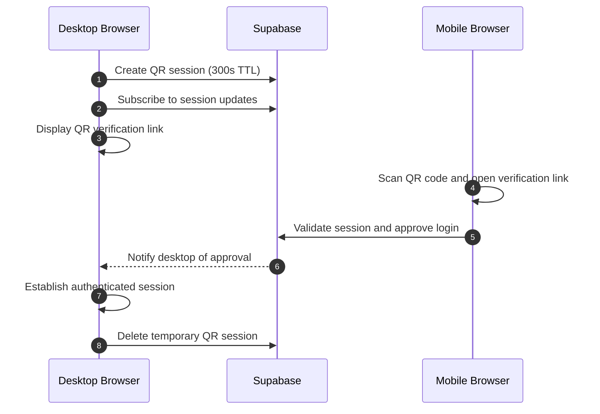

<div align="center">


<p align="center">
  
  
  
  
  
  
  
</p>

[](https://oasis-blog-one.vercel.app/)

<p align="center">
  <a href="https://oasis-blog-one.vercel.app" target="_blank" rel="noopener noreferrer">
    <strong>Explore OASIS</strong> ↗
  </a>
</p>

[](https://oasis-blog-one.vercel.app/)

</div>

---

## 📋 Table of Contents

1. [About OASIS](#about-oasis)
2. [Features](#features)
3. [Tech Stack](#tech-stack)
4. [Technical Highlights](#technical-highlights)
5. [Project Structure](#project-structure)
6. [Privacy & Security](#privacy--security)

---

## About OASIS

OASIS is a digital space designed for people who value thoughtful content over endless scrolling.

Built around the principles of Swiss minimalism, it offers a calm environment for writers, photographers, and creatives to share stories, explore ideas, and connect through meaningful conversations.

No endless scrolling or opaque engagement loops. Just thoughtful content, transparent discovery, and a creative community — at a human pace.

---

## Features

### ✍️ Editorial Publishing

- Rich-text article editor with customizable titles, subtitles, and categories.
- Cover image uploads with instant previews.
- Draft management, live previews, and author-only editing.

### 🌐 Discovery & Community

- **Tri-Modal Discovery Feed:**
  - ✦ For You — personalized, score-based recommendations.
  - Latest — chronological publications.
  - Top — community-engagement ranking.
- Search stories and creators.
- Six curated categories with dedicated subcategories.
- Public creator profiles, following, and threaded discussions.

### 🔖 Personal Collections

- Private bookmarks and saved article collections.
- Personalized following feed with creator recommendations.
- Native sharing with direct links and social shortcuts.

### 🔐 Authentication & Security

- Email/password and Google OAuth authentication.
- Cross-device QR authentication.
- Account management and active session controls.

### 🔔 Real-Time Experience

- Live notifications powered by Supabase Realtime.
- Notification preferences and synchronized unread counts.

### 📊 Creator Analytics

- Rolling 30-day performance analytics.
- Follower growth and story engagement metrics.
- Bookmark statistics and adaptive baseline indicators.

---

## Tech Stack

### Frontend
- **React 19**
- **Vite 8**
- **React Router v7**
- **React Context API** (Auth, Notifications & Toast)
- **GSAP 3.12 & ScrollTrigger**
- **CSS3** (Modular Architecture, Flexbox & Grid)

### Backend & Infrastructure
- **Supabase** (PostgreSQL, Auth, Realtime, Storage, Row Level Security)

### Design
- **Figma**
- **Adobe Illustrator**
- **Sora & Inter** Typography

---

## Technical Highlights

### 1. Cross-Device QR Authentication
OASIS implements a cross-device authentication bridge enabling desktop authentication through mobile verification:



- **QR Session**: Temporary session record with a 300-second validity window, tracked through database timestamps and a client-side countdown.
- **Mobile Approval**: Verification and authorization performed directly on the mobile verification route (`/qr-auth`), which validates session expiration against database timestamps before permitting approval.
- **Desktop Authentication**: Desktop detects approval via Supabase Realtime channel (with automatic polling fallback), establishes the authenticated session via `supabase.auth.setSession()`, and deletes the temporary record upon completion.

### 2. 30-Day Rolling Analytics Engine
The creator dashboard calculates rolling performance telemetry by comparing the trailing 30-day period with the preceding 30-day window:

**Formula:**

```
Δ% = ((M_30d - M_prev30d) / M_prev30d) × 100
```

**Where:**
- `M_30d` — metric value for the trailing 30 days.
- `M_prev30d` — metric value for the preceding 30 days.

**Baseline Handling:** When the prior period metric equals zero (or for accounts under 30 days old), percentage change is mathematically undefined. The dashboard applies an adaptive baseline threshold to indicate initial growth without division-by-zero errors.

### 3. Smart Discovery & Feed Ranking Engine
OASIS features a custom weighted scoring engine that combines engagement signals, time decay, and user affinity to rank stories in the **✦ For You** feed (drawing inspiration from Hacker News time-decay gravity and Pinterest's long-term value model):

**Scoring Model:**

```
Engagement = 4S + 3C + 2L
Decay = (Engagement + 1.2) / (HoursOld + 2)^1.35
SmartScore = Decay * Affinity
```

**Where:**
- `S` — saves (weight: 4).
- `C` — comments (weight: 3).
- `L` — likes (weight: 2).
- `Affinity` — personalization multiplier (1.4 for followed creators, 1.3 for preferred categories, or 1.82 when both apply).

```javascript
// 1. Value-Weighted Engagement (Saves: 4x, Comments: 3x, Likes: 2x)
const engagement = (saves * 4) + (comments * 3) + (likes * 2);

// 2. Time-Decay Gravity (Power decay factor: 1.35)
const decayScore = (engagement + 1.2) / Math.pow(hoursOld + 2, 1.35);

// 3. User Affinity Multipliers (+40% followed authors, +30% favorite categories)
let multiplier = 1.0;
if (isFollowedAuthor) multiplier *= 1.4;
if (isPreferredCategory) multiplier *= 1.3;

const smartScore = decayScore * multiplier;
```

- **Author Diversification:** Queue-based interleaving prevents consecutive stories from the same author in the **✦ For You** feed, creating a more varied discovery experience.

### 4. Swiss Minimalist Design System
- Minimalist palette of pure whites, deep navy (`#0F172A`), and slate tones.
- **Sora** for headlines and **Inter** for editorial typography.
- Vogel spiral-based image distribution in the Orbital Gallery.
- Responsive mobile dock navigation with iOS safe-area support.

---

## Project Structure

```
oasis_blog/
├── design/                             # Brand identity assets (logo.ai, favicon.ai)
├── supabase_setup.sql                  # PostgreSQL schema, RLS policies, tables & triggers
├── oasis-react/                        # React 19 Single Page Application
│   ├── public/assets/                  # Video showcases (orbital.gif, landing.gif) & brand images
│   ├── src/
│   │   ├── components/                 # Core UI building blocks (Header, PostCard, TabBar, etc.)
│   │   ├── context/                    # Global state providers (Auth, Notifications, Toast)
│   │   ├── pages/                      # Application route views (Discover, Studio, Analytics, etc.)
│   │   ├── utils/                      # Smart feed ranking engine (feedAlgorithm.js)
│   │   ├── assets/css/                 # Modular stylesheets per view and component
│   │   ├── App.jsx                     # Route architecture, auth guards & navigation
│   │   └── main.jsx                    # Application entry root
│   └── vite.config.js                  # Vite bundler configuration
└── README.md
```

---

## Privacy & Security

- **Row Level Security:** PostgreSQL policies protecting user data and restricting database operations.
- **Guest Access:** Public content is accessible without authentication, while protected interactions require sign-in.
- **Privacy & Cookie Management:** Consent preferences with `localStorage` persistence, alongside dedicated Privacy Policy, Cookie Policy, and Terms pages.
