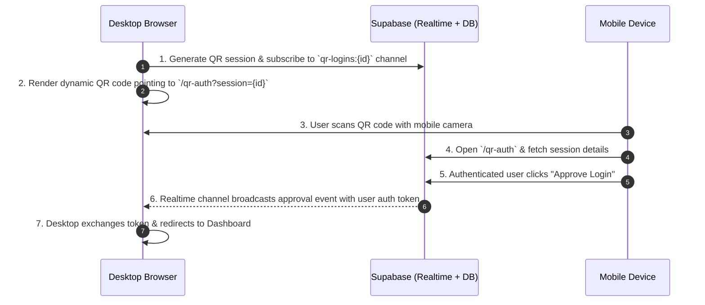

<div align="center">
  <br />
  <a href="https://github.com/vacalincy/oasis_blog" target="_blank">
    <!-- Top Hero Visual: Orbital Animation -->
    
  </a>
  <br />
  <br />

  <div>
    
    
    
    
    
    
    
  </div>

  <h1 align="center">OASIS</h1>

  <p align="center">
    <b>Escape the noise. Curate your reality.</b>
  </p>

  <p align="center">
    A digital sanctuary and modern editorial publishing platform combining human curation, meaningful whitespace, and real-time social architecture.
  </p>

  <br />

  <p align="center">
    
  </p>
</div>

---

## 📋 <a name="table">Table of Contents</a>

1. 📖 [Introduction & Philosophy](#introduction)
2. ⚙️ [Tech Stack Architecture](#tech-stack)
3. 🔋 [Key Features](#features)
4. 🔐 [Cross-Device QR Authentication](#qr-auth)
5. 📊 [30-Day Creator Analytics](#analytics)
6. 🤸 [Quick Start & Setup](#quick-start)
7. 📁 [Project Structure](#project-structure)
8. 🛡️ [Security, Privacy & Compliance](#security)

---

## <a name="introduction">📖 Introduction & Philosophy</a>

The modern internet has devolved into a high-friction battleground of algorithmic manipulation, synthetic urgency, and cognitive exhaustion. Social feeds prioritize outrage over reflection, weaponizing metrics to harvest human attention.

**OASIS** was engineered as an architectural antidote. Designed upon the principles of Swiss minimalism and intentional whitespace, OASIS removes speculative algorithms, vanity counters, and dopamine loops. 

It is a quiet, contemplative digital sanctuary where writers, photographers, and thinkers publish hand-crafted essays, curate personal archives, and engage in thoughtful community dialogue at a human tempo.

---

## <a name="tech-stack">⚙️ Tech Stack Architecture</a>

OASIS is built as a reactive, high-performance Full-Stack Single Page Application (SPA):

### Frontend Engineering
- **React 19** — Functional component architecture, modern hooks (`useTransition`, `useEffect`, `useRef`), and fine-grained state management.
- **Vite 8** — Next-generation frontend tooling offering instant Hot Module Replacement (HMR) and optimized rollup production bundles.
- **React Router v7** — Declarative SPA routing, protected route guards (`ProtectedRoute`), dynamic parameter matching (`/profile/:id`, `/edit-post/:id`), and custom scroll management (`ScrollObserver`).
- **Context API** — Global distributed state layer orchestrating:
  - `AuthContext`: Real-time session monitoring, profile hydration, and multi-device auth state.
  - `NotificationContext`: Real-time WebSocket event dispatching and notification badge synchronization.
  - `ToastContext`: Non-blocking, animated alert feedback system.
- **GSAP 3.12 (GreenSock) & ScrollTrigger** — Kinetic headline reveals, split-word text sequencing (`SplitText`), and scroll-driven choreographies.
- **Modular CSS3 & Glassmorphism** — Independent component/page stylesheets, hardware-accelerated CSS keyframes, subtle backdrop filters (`backdrop-filter: blur`), and iOS mobile safe-area insets.
- **Brand & Visual Design** — Custom branding, typography scales (Sora & Inter font pair), and vector assets authored in **Adobe Illustrator** (`logo.ai`, `favicon.ai`) and **Figma**.

### Backend & Cloud Infrastructure (BaaS)
- **Supabase** — Headless backend-as-a-service infrastructure:
  - **PostgreSQL Database**: Relational schema powering profiles, stories, comments, likes, saves, and follows.
  - **Supabase Auth**: Secure email/password login, Google OAuth, session validation, and age gating.
  - **Supabase Realtime**: WebSocket channels powering instant notifications, live follower updates, and cross-device QR code handshakes.
  - **Supabase Storage**: Distributed CDN buckets for high-resolution article cover photography and user avatars.
  - **Row Level Security (RLS)**: Fine-grained PostgreSQL security policies enforcing author-only mutation rights.

---

## <a name="features">🔋 Key Features</a>

### ✍️ Editorial Creator Studio
- **Rich Publishing Suite**: Dynamic article creation with customizable titles, subtitles, and category taxonomy.
- **Drag-and-Drop Media Upload**: Direct-to-bucket image upload pipeline to Supabase Storage with client-side preview.
- **Draft & Publish Lifecycle**: Authors can save works in progress as private drafts or broadcast them immediately.
- **Author Story Management**: Full editing capabilities (`/edit-post/:id`) and secure deletion dialogs restricted strictly to the story's creator.

### 🌐 Social Architecture & Discovery
- **Zero-Noise Human Curation**: Feeds arranged chronologically and thematically without algorithmic sorting or shadow ranking.
- **Live Search & Exploration**: Instant dropdown search in header for live story and author lookup, alongside a comprehensive search results view (`/search`).
- **Curated Following Feed**: Dedicated chronological timeline of followed authors with an intelligent empty state offering curated creator recommendations and topic pills.
- **Deep Category Taxonomy**: Six core curated verticals (Photography, Architecture, Design, Culture, Technology, Travel) with granular subcategories and filters.
- **Public Creator Profiles**: Dynamic profile pages (`/profile/:id`) featuring hero-fade backdrop blur, biographical narratives, published works, and interactive follow toggles.
- **Community Dialogue**: Multi-level nested discussion threads on articles with relative timestamps, author avatars, and reply trees.
- **Private Bookmarks & Saved Collections**: Save editorial reads to personal archives without public broadcast.
- **Custom Native Share Modal**: One-click link copying with toast notifications and native sharing to Twitter/X, LinkedIn, and Telegram.

### ⚙️ Account Security & Granular Settings
- **Notification Customization**: Granular switches to enable/suppress in-app alerts and digest notifications.
- **Email Verification & Change Pipeline**: In-app email modification workflow featuring confirmation links and pending state cards.
- **Password Management**: Secure credential updating requiring current password authentication.
- **Multi-Device Session Control**: Visibility over active device sessions with the capability to log out other remote hardware.

---

## <a name="qr-auth">🔐 Cross-Device QR Authentication</a>

OASIS features a custom cross-device authentication protocol allowing users on desktop to log in instantaneously by scanning a QR code with their mobile device.



- **Dual-Layer Synchronization**: Combines **Supabase Realtime WebSockets** with an automatic **HTTP polling fallback** (2.5s) to guarantee instant handover even over unstable mobile cellular networks.
- **Session Expiration & Rejection**: Time-bounded validity with instant UI feedback if declined by the mobile device.

---

## <a name="analytics">📊 30-Day Creator Analytics</a>

Built into the creator's private dashboard (`/dashboard`), the **OverviewStatsCard** computes live rolling performance telemetry over a 30-day window:

- **Follower Velocity**: Compares new followers acquired over the trailing 30 days against the preceding 30-day period:
  $$\Delta \% = \frac{\text{Followers}_{30\text{d}} - \text{Followers}_{\text{prev } 30\text{d}}}{\text{Followers}_{\text{prev } 30\text{d}}} \times 100$$
- **Engagement & Story Likes**: Aggregates likes across all published stories authored by the creator, charting percentage momentum.
- **Reading Saves & Bookmarks**: Real-time counter of community bookmarking, providing meaningful feedback without toxic vanity metrics.
- **Smart Grace Period**: Automatically adapts messaging for new accounts under 30 days old to present clear baseline indicators.

---

## <a name="quick-start">🤸 Quick Start & Setup</a>

Follow these instructions to run OASIS locally in your development environment.

### Prerequisites
- [Node.js](https://nodejs.org/) (v18 or higher)
- [npm](https://www.npmjs.com/) or [pnpm](https://pnpm.io/)
- A free [Supabase](https://supabase.com/) account

### 1. Clone the Repository
```bash
git clone https://github.com/vacalincy/oasis_blog.git
cd oasis_blog/oasis-react
```

### 2. Install Dependencies
```bash
npm install
```

### 3. Configure Environment Variables
Create a `.env` file in the `oasis-react/` folder:

```env
VITE_SUPABASE_URL=https://your-supabase-project-id.supabase.co
VITE_SUPABASE_ANON_KEY=your-supabase-anon-key
```

### 4. Database Setup
Initialize the database tables, triggers, storage bucket, and Row Level Security policies using `supabase_setup.sql`:

```bash
# Execute supabase_setup.sql in your Supabase SQL Editor
```

### 5. Launch the Development Server
```bash
npm run dev
```

Open [http://localhost:5173](http://localhost:5173) in your browser.

---

## <a name="project-structure">📁 Project Structure</a>

<details>
<summary><code>Click to expand repository architecture</code></summary>

```
oasis_blog/
├── design/                             # Brand assets & vectors (logo.ai, favicon.ai)
├── supabase_setup.sql                  # PostgreSQL schema, tables, storage, and RLS policies
├── oasis-react/                        # Main React 19 Frontend Application
│   ├── public/
│   │   └── assets/
│   │       ├── video/                  # Showcase recordings (orbitral.gif, landing.gif)
│   │       └── images/                 # Editorial visuals, icons, and avatars
│   ├── src/
│   │   ├── components/                 # Reusable UI components
│   │   │   ├── Header.jsx              # Navigation bar with live search & notifications
│   │   │   ├── Footer.jsx              # Editorial footer with manifesto links
│   │   │   ├── PostCard.jsx            # Standardized article preview card
│   │   │   ├── CommentItem.jsx         # Nested discussion thread item
│   │   │   ├── TabBar.jsx              # Mobile bottom navigation dock
│   │   │   ├── CookieBanner.jsx        # GDPR cookie consent controller
│   │   │   ├── OverviewStatsCard.jsx   # 30-day creator analytics engine
│   │   │   ├── SplitText.jsx           # GSAP kinetic word-split typography
│   │   │   └── ProtectedRoute.jsx      # Client-side authentication guard
│   │   ├── context/                    # Centralized React Context providers
│   │   │   ├── AuthContext.jsx         # Supabase Auth & session lifecycle
│   │   │   ├── NotificationContext.jsx # Real-time notification subscriptions
│   │   │   └── ToastContext.jsx        # Floating toast notification feedback
│   │   ├── pages/                      # Application route views
│   │   │   ├── LandingPage.jsx         # Hero showcase, QR login, and manifesto
│   │   │   ├── DiscoverPage.jsx        # Primary editorial feed
│   │   │   ├── FollowingPage.jsx       # Followed creators feed & empty state
│   │   │   ├── PostPage.jsx            # Article reader, comments, and interactions
│   │   │   ├── AddPostPage.jsx         # Creator publishing studio & story editor
│   │   │   ├── DashboardPage.jsx       # Creator workspace, drafts, and analytics
│   │   │   ├── ProfilePage.jsx         # Dynamic public profile & collection view
│   │   │   ├── PopularPage.jsx         # Trending stories & discussion threads
│   │   │   ├── TopicsPage.jsx          # Visual thematic topic taxonomy
│   │   │   ├── CategoryPage.jsx        # Granular category exploration & filters
│   │   │   ├── QrAuthPage.jsx          # Mobile cross-device login approval view
│   │   │   ├── SettingsPage.jsx        # Security, session, and profile preferences
│   │   │   ├── SupportPage.jsx         # Searchable FAQ knowledge base
│   │   │   ├── ContactPage.jsx         # Support inquiry form
│   │   │   └── CookiePolicyPage.jsx    # Privacy & compliance documentation
│   │   ├── assets/css/                 # Modular page stylesheets
│   │   ├── constants/                  # Category taxonomies and configuration
│   │   ├── supabaseClient.js           # Supabase client singleton
│   │   ├── App.jsx                     # Route registry & title scroll observer
│   │   └── main.jsx                    # Application entry root
│   ├── index.html                      # HTML entry with OpenGraph SEO & GSAP CDNs
│   └── vite.config.js                  # Vite configuration & dev server host settings
└── README.md                           # Project showcase & documentation
```

</details>

---

## <a name="security">🛡️ Security, Privacy & Compliance</a>

- **PostgreSQL Row Level Security (RLS)**: Every database table (`posts`, `comments`, `profiles`, `qr_logins`) enforces strict RLS policies ensuring that users can only mutate their own content.
- **Guest Access Control**: Unauthenticated guests can seamlessly read articles and explore categories, but writing, commenting, following, and bookmarking are protected by automatic auth prompts.
- **Cookie Compliance (GDPR)**: Built-in `CookieBanner` with persistent consent state stored in `localStorage`, accompanied by a dedicated Cookie Policy (`/cookies`), Terms of Service (`/terms`), and Privacy Policy (`/privacy`).
- **Input Sanitization**: Content input is guarded to prevent Cross-Site Scripting (XSS) during rich text rendering.
